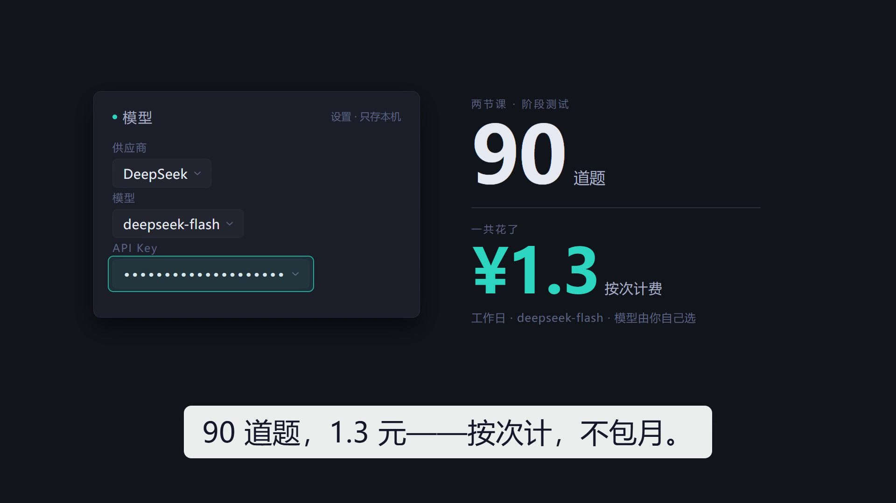

# Spore 宣传片（spore-promo）



Spore（孢子）系列的宣传片工程：Remotion 4 源码 + 真实界面素材采集脚本 + 分镜/声音规格。
成片 `public/out/v2/spore-v2-final.mp4`（1920×1080 / 30fps / 87s / I −18.8 LUFS）。

三端产品见 [Spore](https://github.com/Offblink/Spore)（网页扩展）、
[Spore-Mobile](https://github.com/Offblink/Spore-Mobile)、
[Spore-GUI](https://github.com/Offblink/Spore-GUI)。

> **v2（2026-11-14）**：87s / 2610 帧 / 10 个镜头，台词逐句来自《移动开发课程设计——Spore》。
> 规范在 [`design-spec-v2.md`](design-spec-v2.md)，时间在 `src/v2/timeline.ts`，声音在 `src/v2/audio.ts`，
> 源码在 `src/v2/`，合成 id `SporePromoV2`。v1（下面的六段式 70s）**原样保留**，两版并存于同一入口。
>
> ```bash
> npx remotion render src/index.ts SporePromoV2 public/out/v2/spore-v2-mix.mp4 --browser-executable="C:\Program Files (x86)\Microsoft\Edge\Application\msedge.exe"
> # 再归一化到交付口径（见下「响度交付」）
> ```
>
> v2 的镜头：A1 题库痛点 → A2 大模型痛点 → B Agent/Fungi 登场（菌丝网络）→ C 三端并置 + 云端脉冲
> → C2 手机独有（启动画面全过程 41 帧 1:1 播回 + 拍照搜题）→ D 搜题记录四态 + **明切暗**
> → E1 答题界面→抽屉滑出（14 帧真实动画）→ E2 手机+桌面并排（球→半屏面板 / 桌面收进后台）→ F 自备 API + 90 题 ¥1.3 → G 收束成孢子点。
>
> **响度交付**：Remotion 直出的混音是 I −27.9 LUFS（床压得低），交付前统一过一次固定增益 + 限幅：
> ```bash
> ffmpeg -i public/out/v2/spore-v2-mix.mp4 -c:v copy \
>   -af "volume=9.9dB,alimiter=limit=0.72:level=disabled" -c:a aac -b:a 192k -ar 48000 \
>   public/out/v2/spore-v2-final.mp4
> ```
> 实测：I −18.8 LUFS / LRA 5.9 LU / True peak −1.7 dBFS（原混音 −27.9 / 7.8 / −6.6）。
> 只出一版。要无 BGM 的 stem（后期自己配乐）再加 `--props=props-nobgm-v2.json` 渲一次，别默认渲。
>
> 深色素材：`SPORE_THEME=dark python capture/capture.py`（同名加 `-dark` 后缀，不写 layout.json）。
> 启动页抽帧：同一条 capture 命令里的 `shot_anim`（150/350/550/1300ms）。

Spore 产品宣传片：**Remotion 4.0.484，2100 帧 / 70s / 1920×1080 @30fps**，
六段镜头（S1 框选急推 → S2 三端嵌入 → S3 搜题记录四态 → S4 手机桌面同步 →
S5 记录墙四句 → S6 剥离收尾字标）。设计权威是 [`design-spec.md`](design-spec.md)
（含逐字稿、帧级时间轴、裁决痕迹）；时间权威是 `src/timeline.ts`。

## 增量改片（不要每次整片重渲）

两个工具，按场景选：

```bash
# ① 已有成片，只改一两个镜头 —— 外科手术（渲染 1–2 min + 拼接 ~2 min）
node scripts/patch-shot.mjs E
node scripts/patch-shot.mjs E,G

# ② 从零建整片 / 大面积改（逐镜缓存，之后每镜 1–2 min）
node scripts/render-seg.mjs
node scripts/render-seg.mjs --shots C --no-assemble
node scripts/render-seg.mjs --extract-audio=public/out/v2/spore-v2-mix.mp4   # 声音变了才要跑
```

- 镜头边界**只从 `src/v2/timeline.ts` 解析**，两个脚本都没有第二份时间表。
- `patch-shot`：只渲改动镜头（带该段音频），再用一次 `filter_complex` 按**帧号**把那段换进旧成片；
  其余帧原样解码后重编一次（x264 crf18），避免 `-c:v copy` 在关键帧边界花屏。
  ⚠ 换进来的那段音频必须 `atrim` 到**视频秒数**：Remotion 每段音频比画面长约 1 帧（AAC padding），
  不裁的话 concat 按声音时长排段，后面每段往后蹭一帧，patch 三次就攒出 0.2s 音画错位（2026-11-14 踩过）。
- `render-seg`：每段 `--muted` 渲到 `_seg/`，音轨单独缓存 `_audio.m4a`（段带音频时 AAC 尾部
  ~56ms padding，9 段拼起来会攒出半秒错位），拼接时 `-c copy` 挂音轨。
- 什么时候真的只能整片重渲：改 tokens / 底色 / 时间轴（镜头边界变了，所有段都要重排）。

## 怎么改文案

1. **先改 `design-spec.md` §「S1–S6 逐字稿」**（它是权威，装配时不许改字）。
2. 把改动镜像进 `src/timeline.ts` 的 `SHOTS[].captions`（`from/to` 是绝对帧，
   `to` = 含端点最后一帧 = `from + dur - 1`）。
3. 字幕样式/位置只有一个实现点：`src/SporePromo.tsx` 的 `<Captions/>`
   （bottom 96、fontSize 60、进出各 8f 淡入淡出）——**镜头文件里不许再写字幕**。
4. `npx tsc --noEmit` → 重渲（见下）。字幕层在所有 `<Sequence>` 之外，
   永远用合成绝对帧，不会被镜头 transform 带跑。

改动 S6 收尾的三端小字/仓库地址在 `src/shots/S6.tsx`（fontSize 44，
Q11 下限：辅助文字 ≥32px 有效字高，2026-11-07 终检从 20px 修正）。

## 怎么重渲

```bat
cd spore-promo
npx tsc --noEmit
python verify-ground.py                   :: 时间轴/字幕/取样帧断言，应 ALL PASS
npx remotion render src/index.ts SporePromo public/out/promo.mp4 --browser-executable="C:\Program Files (x86)\Microsoft\Edge\Application\msedge.exe"
npx remotion render src/index.ts SporePromo public/out/promo-nobgm.mp4 --props=props-nobgm.json --browser-executable="C:\Program Files (x86)\Microsoft\Edge\Application\msedge.exe"
```

- **`--browser-executable` 必带**，否则 Remotion 会去下载 chrome-headless-shell（GFW 下会卡死）。
- 两版必须同源：无 BGM 版走 `--props=props-nobgm.json`（`{"bgm":false}`，Windows 必须走文件，
  不能内联 JSON），SFX 两版都在。
- 单张静帧：`npx remotion still src/index.ts SporePromo <输出.png> --frame=N --browser-executable=...`
- 混音验收：`ffmpeg -i <mp4> -af ebur128=peak=true -f null -`（贴 I / LRA / True peak，不许削波）。
- 整片 2100 帧约 20 分钟/版（本机 Edge、无并行卡时）。

## 工作台怎么开

```bat
cd spore-promo
npm run dev        :: = remotion studio src/index.ts，浏览器里逐镜头预览/改参数
```

## 音频（BGM 与 SFX 授权）

- **唯一音频数据源：`src/audio.ts`**（SFX 钉帧表 + BGM 参数），渲染层 `src/RootAudio.tsx`。
  - 落帧公式（硬规则，禁止裸绝对帧号）：
    `from = round(SHOTS[shot].from + offset − peakLag − OUTPUT_OFFSET_FRAMES)`
  - `OUTPUT_OFFSET_FRAMES = 1.28`（AAC priming 先验值，2026-11-07 渲后 4 探针交叉相关回测：
    残差 −0.16 / −2.47 / +2.22f，符号不一致 = 无系统性偏移，均值 ≈ −0.14f → 常数维持）。
- **BGM 授权**：[`public/audio/BGM-ATTRIBUTION.md`](public/audio/BGM-ATTRIBUTION.md)
  （house-vibez — Lily J / Mixkit，BPM 123、相位与镜头边界残差记在 `audio.ts` 注释里）。
- **SFX 授权**：[`public/audio/sfx/FREESOUND-CREDITS.md`](public/audio/sfx/FREESOUND-CREDITS.md)
  （逐条：文件 — 标题 — 作者 — 素材页 — CC0 — 注明是 MP3 预览非无损原档）+
  [`public/audio/sfx/audio-manifest.json`](public/audio/sfx/audio-manifest.json)（sha256、许可 URL、实测数据）。
- 音源全部 Freesound CC0；响度与可闻性口径见 `audio.ts` 头注（2026-11-07 终检第二轮实测：
  BGM 0.10、8 条埋没 SFX 抬到床峰 +3dB 线上，阶梯相对递减保留，未试听只有测量结论）。

## 质检与素材

- `python verify-ground.py` — 时间轴连续性/13 条字幕无重叠/取样帧 local frame/`PAGES`/`BBOX` 对账。
- `python capture/check_safety.py` — 数据安全扫描（路径/邮箱/手机号/key/真实厂商名，0 命中口径）。
- 终检抽帧：`public/out/qa/review-*.png`（六镜 21 帧，帧号标签在文件名）。
- 纹理：`public/textures/`（14 张真图 + `layout.json` 14 页 18 元素 bbox，来自 `capture/` 采集），
  **不许改**；改纹理 = 重跑 `capture/capture.py`。
- 静帧产物：`public/out/S*.png`；成片：`public/out/promo.mp4` + `promo-nobgm.mp4`（两版 2100 帧同源）。

## 改动纪律（来自各轮卡面）

- **画面已锁**：改 `src/shots/*.tsx` 前先想清楚——这是方案层还是实现层；
  分镜/文案/时间轴（`timeline.ts`、`plan.json`、`design-spec.md`）= 方案层，走看板 comment。
- 镜头文件里**不许出现绝对帧号**（一律 `SHOTS[shot].from + offset` 派生）。
- 改了镜头时长/顺序 → **SFX 全表重钉**（`audio.ts`），音画错位是交付前必查项。
- 不新增 npm 依赖。

## 许可

代码以 [MIT](LICENSE) 发布。**素材不在此列**，各自沿用原许可：

- `public/textures/**`：Spore 三端产品的界面截图（数据全虚构），界面版权随对应仓库。
- `public/audio/sfx/**`：Freesound，CC0 / CC BY，逐条见 `public/audio/sfx/FREESOUND-CREDITS.md`。
- `public/audio/bgm/house-vibez.mp3`：Mixkit，见 `public/audio/BGM-ATTRIBUTION.md`。
- `src/lib/PageCam.tsx` 等沿用 video-shotcraft 模板（Apache-2.0）。
- 渲染引擎 Remotion 有自己的许可（个人与小团队免费，商业用途可能需要授权）。
